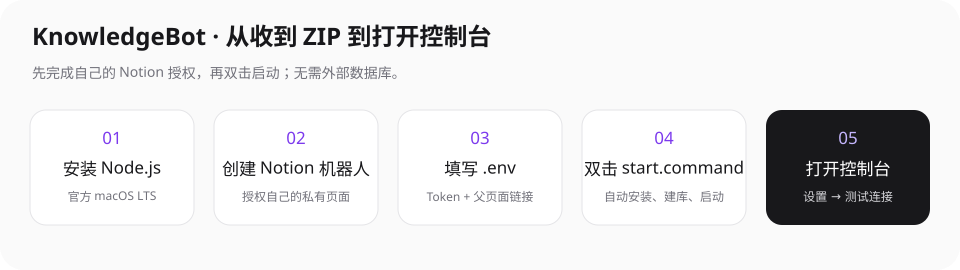
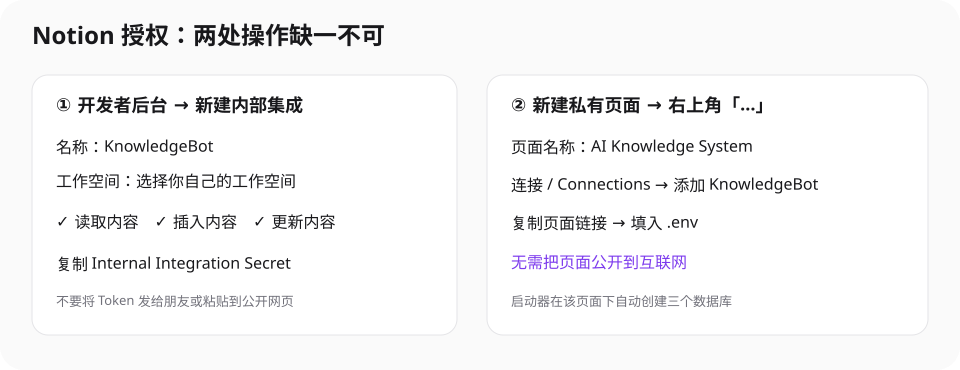
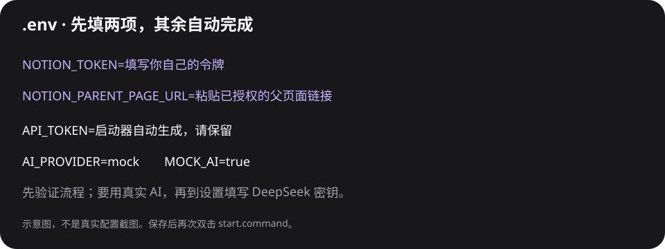

# 朋友零基础部署与使用教程

> KnowledgeBot · macOS 懒人包 v1.0。你收到的是纯净源码包，不是已签名的 `.app` 或离线安装器。首次需要联网安装依赖，并使用你自己的 Notion 和模型账户；以后日常使用不用输入终端命令。不需要注册 Render、PostgreSQL 或 Cloudflare R2。



如果电脑不方便查看 Markdown，直接双击同目录的 **DEPLOY_GUIDE.html**，无需安装阅读器，浏览器会完整显示图文教程。

## 先看这一页：你只需要准备什么？

- 一台 Mac、可访问 Notion 和 npm 的网络、一个 Notion 工作空间。
- 自己创建的 Notion 机器人 Token，以及授权给它的一个私有空页面链接。
- 可选的 DeepSeek API Key。没有也能先用 Mock 跑通流程，但 Mock 不是真实 AI。
- 解压 ZIP，打开里面的 `KnowledgeBot` 文件夹。建议放到自己用户目录下的固定文件夹；不要直接在压缩包内运行，也不要放在 iCloud 同步文件夹里。

首次安装和授权需要几分钟，依赖下载慢时可能更久。此前演示的“秒开”指安装完成后的日常打开，不代表首次下载安装也只需毫秒。

## 第一步：安装运行环境

1. 打开 [Node.js 官方下载页](https://nodejs.org/en/download)，选择 **macOS → LTS → Installer / 安装器（.pkg）**。项目要求 Node.js **22 或更新版本**，建议选当前 LTS。
2. 下载后双击安装器，按系统提示完成安装。Apple 芯片通常选 ARM64，Intel Mac 选 x64；不确定时使用页面提供的 macOS 安装器。
3. 双击 `start.command`。如果没有 Node.js，启动器会打开官方页面并说明原因；安装好后再双击即可。

已有 Homebrew 的高级用户可用这一条命令安装，无需新用户照做：

```bash
brew install node
```

没有 Homebrew 就使用官方 `.pkg`，不要为了运行本项目安装不明来源的脚本。pnpm 不必手动安装：启动器检查项目要求的版本，缺少时自动用 npm 安装到本项目 `.tools/`，不需要 sudo，也不会修改你的全局 pnpm。安装方式参考 [pnpm 官方说明](https://pnpm.io/installation)。

## 第二步：创建并授权 Notion 机器人



这张图是操作示意，不是你的账号截图。Notion 中文菜单可能随版本调整，以“连接 / Connections”为准。

1. 登录自己的 Notion，打开 [Notion 内部集成后台](https://www.notion.so/profile/integrations)。选择 **新建集成 / New integration / New connection**。
2. 名称填写 **KnowledgeBot**，选择你自己的工作空间，类型选择 **内部 / Internal**。不要创建需要公开 OAuth 的集成。
3. 在能力 / Capabilities 中启用 **读取内容、插入内容、更新内容**。本工具不需要读取所有成员邮箱，也不需要公开你的页面。
4. 复制 **Internal Integration Secret / 内部集成令牌**，暂时留在自己的安全位置，稍后填入 `.env` 的 `NOTION_TOKEN`。不要把令牌发给包的作者或朋友。
5. 回到 Notion，在自己的工作空间新建一个**私有空页面**，取名 **AI Knowledge System**。
6. 打开该页面右上角 **`…` → 连接 / Connections → 添加连接**，找到刚才的 **KnowledgeBot** 并添加。若找不到，检查机器人是不是建在同一个工作空间，或联系工作空间管理员。
7. 点击 **复制链接**，保留这条页面链接。**不用公开页面、不用发布网站，也不用给其他用户开放访问。**

集成有 Token 和页面有授权是两件事，少任一步都会报权限错误。官方参考：[创建集成](https://www.notion.com/help/create-integrations-with-the-notion-api)、[管理页面连接](https://www.notion.com/help/add-and-manage-connections-with-the-api)。

## 第三步：填写密钥与配置

首次双击 `start.command` 会自动安装依赖、生成 `.env`、填入一个随机 `API_TOKEN`，并用 TextEdit 打开配置文件。看到“请填写后再次双击”属于正常的首次配置流程，不是安装失败。

如果想手工准备：复制 `.env.example` 一份，改名为 `.env`（保留 `.env.example`）。Finder 隐藏点号文件时按 **⌘⇧.** 显示；不要保存成 `.env.txt`，也不要使用富文本格式。手工创建时可用以下命令生成 API Token：

```bash
node -e 'console.log(require("node:crypto").randomBytes(32).toString("hex"))'
```

将输出只粘贴到你自己的 `.env` 的 `API_TOKEN=` 后。自动生成过的 Token 不必修改。



最少填写两行：

```dotenv
NOTION_TOKEN=你自己的Notion内部集成令牌
NOTION_PARENT_PAGE_URL=你刚才授权的私有父页面链接
```

保存文件（**⌘S**），再次双击 `start.command`。启动器会在该父页面下自动创建：

| 数据库 | 用来做什么 |
| --- | --- |
| Knowledge Base | 保存资料、摘要、评分和提醒 |
| Collections | 保存专题、关联资料和周报 |
| AI Jobs | 追踪导入、总结和导出任务 |

三个 `NOTION_*_DATA_SOURCE_ID` 由启动器写回配置，不需要手工抄 ID 或搭建字段。如果中途失败，再次双击会尝试从已完成的步骤继续；若父页面里有多个同名数据库，会停止并提示，不会猜测或删除数据。建议为本工具使用一个新的空父页面。

已有完整数据库的高级用户可以直接填写三个 data source ID；不要把数据库视图 ID 填进来。

### 想立即使用真实 DeepSeek？

可在 [DeepSeek 官方平台](https://platform.deepseek.com/) 创建自己的 API Key 并确认账户有可用额度，然后填写：

```dotenv
AI_PROVIDER=deepseek
MOCK_AI=false
DEEPSEEK_API_KEY=你自己的DeepSeek密钥
```

也可以先保留 Mock，启动后到 **设置与备份 → DeepSeek → 粘贴密钥 → 测试 AI 连接**。模型名称由系统默认选择；模型服务的有效性与余额仍取决于你自己的账户，不随源码包赠送。

## 第四步：双击启动，开始使用

安装完成后，`start.command` 会自动打开 **http://localhost:3000**。`install-and-run.command` 是同一个入口的别名；`KnowledgeBot.command` 是完成首次配置后的轻量启动器。

日常只需要双击启动器或打开已保存的浏览器快捷方式：服务常驻时不会重新安装依赖或重新编译。关闭浏览器不会关闭后台服务；要停止，点击 **设置与备份 → 停止本地服务**。电脑重启后再双击一次即可。

进入控制台后依次做这三件事：

1. **设置与备份 → 测试 Notion 连接**，看到验证成功。
2. 使用真实模型时点击 **测试 AI 连接**；Mock 只验证模拟流程。
3. **导入资料 → 网页**，粘贴一条可公开访问的链接，选择重要程度评分、填写亮点备注，再点击导入。任务完成后点击 **打开 Notion 页面**，确认资料确实写入。

之后可以尝试 GitHub、文字笔记、文件拖拽上传、知识问答、专题总结、ZIP 导出恢复和周末复盘。详细操作见控制台右上角 **使用指南 → 日常使用**，本部署教程位于 **使用指南 → 朋友部署**。

### 图片 OCR 首次提示安装开发者工具？

macOS Vision OCR 需要本机 `swift` 编译辅助程序。若系统提示安装 Apple Command Line Tools，请按 Apple 的系统提示完成；高级用户可以运行 `xcode-select --install` 调出安装提示。工具下载可能较大，不属于秒开部分。没有工具或不想安装时，先导入文字/PDF 文本层，或在设置中单独配置视觉 API。DeepSeek 文本模型不会直接识别图片。

## 第五步：遇到问题先这样排查

| 现象 | 如何自救 |
| --- | --- |
| 提示没安装 Node.js | 从官方页面安装 macOS LTS `.pkg`，关闭旧终端窗口，再双击启动器。 |
| pnpm 或依赖下载失败 | 检查网络能否访问 npm 官方仓库；稍后再次双击。不要删除 `.env`、不要粘贴私人密钥到求助截图。 |
| Token 错误 / Notion 401 | 重新复制自己的内部集成令牌，去掉误粘贴的空格，保存 `.env` 后重试。 |
| Notion 403 / 404 | 检查父页面“连接”中是否添加了同一工作空间里的 KnowledgeBot；404 也可能代表没有访问权限。 |
| 父页面链接无法识别 | 重新使用 Notion“复制链接”，粘贴完整 HTTPS 页面链接；不要复制数据库视图链接或浏览器收藏标题。 |
| 3000 端口被占用 | 若是已有 KnowledgeBot，启动器会直接打开它。若被别的程序占用，在 `.env` 把 `PORT=3000` 改为 `PORT=3001`，保存后重新双击；启动器自动读取端口，不会擅自关闭其他程序。 |
| `.command` 提示没有执行权限 | 在终端输入 `chmod +x ` 后把 `start.command` 拖进去，回车，再双击。ZIP 正常解压会保留执行权限。 |
| macOS 阻止打开脚本 | 先核对来源和 ZIP 校验和，仅在确认信任后按 macOS 自己提供的打开流程处理。不要关闭 Gatekeeper、不要移除系统安全保护。 |
| DeepSeek 余额不足 / 超时 | 到自己的官方账户检查额度；在设置中测试连接，或先切回 Mock。 |
| 网页要求登录、导入失败 | 在“网页”表单补充自己有权复制的正文，不要填 Cookie 或尝试绕过站点权限。 |
| 原生 OCR 失败 | 安装 Apple Command Line Tools，或改为单独配置视觉 API；扫描 PDF 默认只 OCR 前五页。 |
| 打开界面但 Notion 尚未连接 | 界面先呈现本地缓存，后台连接有独立状态；检查设置和任务记录，不要把界面打开等同于所有外部 API 可用。 |

更多诊断在 `work/server.log`，首次安装错误显示在启动器终端中。求助时只提供错误码和脱敏截图，不要发送 `.env`、`data/config.json` 或完整资料库。

## 保存在哪里？怎么备份？

- `.env` 与 `data/config.json`：你自己的明文密钥配置，权限限制为当前用户可读写，切勿分享。
- `data/pglite/`：本地索引与任务数据库，不需要安装 PostgreSQL。
- `data/storage/`：默认的附件与 ZIP 目录，可在设置页切换到本地 iCloud Drive 路径。
- 正式资料仍在你自己的 Notion 中；源码包里没有作者的 Notion 内容。

备份前在 GUI 停止服务，再保存数据库与附件；Notion 另做官方导出。iCloud 附件同步不是完整备份。程序不能保证两份配置同时丢失后还能恢复。

## 我怎样把它继续分享给别人？

不要直接压缩你已经使用过的整个项目文件夹，那样可能带出自己的密钥和资料。开发者应运行项目提供的 `scripts/package-release.mjs` 重新生成白名单纯净包，再分享 `outputs/` 中对应的 ZIP 和 `.sha256` 文件。对方必须创建自己的机器人和模型密钥，不能使用你的凭证。

## 修订记录

- v1.0：朋友首次安装、Notion 自动初始化、配置、使用、备份与故障自救。
